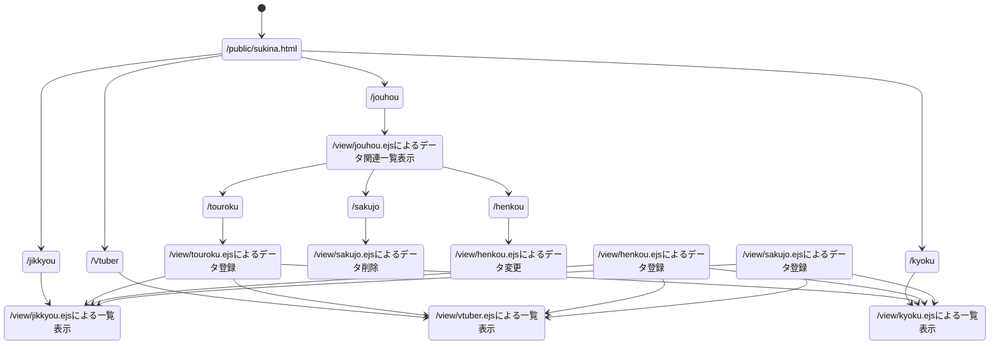

##私の好きな〇〇一覧

<!--
好きな曲　アーティスト名　再生回数　URL
好きな実況者一覧 チーム名　youtube登録者数　動画本数 URL
好きなVtuber一覧　会社名　youtube登録者数　動画本数 URL

好きな曲
d1　プロポーズ
d2　ダーリン
d3　ラヴィ
d4　モエチャッカファイア
d5　一旦ステイ Tonight
d6　パイナップルパーク
d7　シャルル

好きな実況者
d1　らっだぁ
d2　ぺいんと
d3　ぐちつぼ
d4　ととみっくす
d5　nquse
d6　
d7
-->

